# PMDAA management anchor graph

Solid arrows ground or extend; dotted arrows are counterpoints. Copy labels exactly. Each anchor names the ledger field or
check it justifies.

```mermaid
flowchart TB
  subgraph DIRECTION["DIRECTION"]
    northstar["North Star Metric: one outcome all work serves (Sean Ellis, Hacking Growth)"]
    okr["Objectives and Key Results (Doerr, Measure What Matters)"]
    stowner["Single-threaded owner (Bryar and Carr, Working Backwards)"]
  end
  subgraph FLOW["FLOW"]
    kanban["Kanban: visualize work, limit WIP (David J. Anderson, Kanban)"]
    littles["Little's law: lead time = WIP / throughput (John Little)"]
    toc["Theory of Constraints: exploit the bottleneck (Goldratt, The Goal)"]
    cod["Cost of delay and WSJF (Reinertsen, The Principles of Product Development Flow)"]
    nextaction["Next action: the next physical, visible step (David Allen, Getting Things Done)"]
    weekly["Weekly review: get clear, get current (David Allen, Getting Things Done)"]
  end
  subgraph SCHEDULE["SCHEDULE"]
    cpm["Critical Path Method (Kelley and Walker, 1959)"]
    milestones["Milestone with exit criteria (Schwaber and Sutherland, Scrum Guide: Definition of Done)"]
    refclass["Reference class forecasting (Flyvbjerg, How Big Things Get Done)"]
  end
  subgraph CONTROL["CONTROL AND EVIDENCE"]
    rag["RAG status backed by evidence (PRINCE2 highlight report)"]
    raid["RAID log: risks, assumptions, issues, dependencies (PRINCE2 / PMBOK)"]
    adr["Architecture Decision Records (Nygard)"]
    andon["Andon cord: stop the line on a defect (Ohno, Toyota Production System)"]
    pdca["Plan-Do-Check-Act (Deming, Out of the Crisis)"]
    gemba["Go and see: genchi genbutsu (Liker, The Toyota Way)"]
    ci["Continuous integration: the build is the truth (Fowler, Continuous Integration)"]
  end
  subgraph LIMITS["PEOPLE AND LIMITS"]
    brooks["Adding people to a late project makes it later (Brooks, The Mythical Man-Month)"]
    goodhart["Goodhart's law: a measure that becomes a target stops measuring (Goodhart; Strathern)"]
    watermelon["Watermelon status: green outside, red inside (project-management folklore)"]
    cynefin["Cynefin: complex work needs probes, not plans (Snowden and Boone)"]
  end
  subgraph LEDGER["LEDGER FIELDS"]
    f_north["north_star"]
    f_ms["milestone.exit_test"]
    f_rag["rag + rag_evidence"]
    f_live["live (refresh) vs evidence (claimed)"]
    f_next["next_actions (max 3)"]
    f_raid["raid"]
    f_dec["decisions"]
    f_dep["depends_on: critical path"]
    f_wip["wip_limit"]
    f_owner["owner"]
    f_verified["last_verified"]
  end

  northstar --> okr
  northstar --> f_north
  okr --> milestones
  okr -.->|counterpoint: goals are not strategy| cynefin
  stowner --> f_owner
  milestones --> f_ms
  refclass -.->|dates from the reference class, not hope| milestones
  littles --> kanban
  kanban --> f_wip
  kanban -.->|limits are a means, not a score| goodhart
  toc --> cpm
  cpm --> f_dep
  cod --> nextaction
  nextaction --> f_next
  weekly --> f_verified
  weekly --> pdca
  pdca --> f_live
  gemba --> f_live
  ci --> f_live
  ci --> andon
  andon --> rag
  rag --> f_rag
  watermelon -.->|green needs evidence| rag
  gemba -.->|the ledger is a map; the repo is the territory| f_rag
  raid --> f_raid
  adr --> f_dec
  brooks -.->|more agents on a late project| f_wip
  cynefin -.->|research and partnerships resist milestones: use probes with exit tests| f_ms
  goodhart -.->|exit tests can be gamed: read the work too| f_ms
```

## How the anchors drive a session

- **Resume** = Weekly review + Go and see: read the ledger, then look at the repo and CI before believing it.
- **Stale claim** = the watermelon check: a green status whose evidence predates HEAD is re-verified or downgraded.
- **Next action** = Theory of Constraints + Critical Path + Cost of delay, bounded by the Kanban WIP limit.
- **Close** = PDCA: the ledger records what was checked and what the next session does first.
